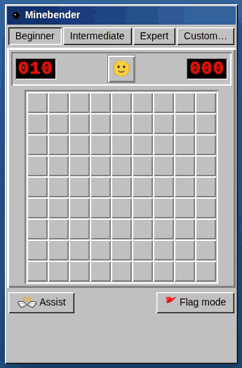

# minebender

*A Beginner board: three clicks leave a true 50/50 in the bottom-right corner (two mines on one of
the 2×2's diagonals, every number the same either way). No cell can be deduced, so the assist opens
a safe one instead of making you guess.*

Minesweeper with a no-guess assist button, written in [Bend 2](https://bend-lang.com)
as a trial of law-driven development. **Play: https://cleto.dev/minebender/**

- `LAWS.bend`: the specification, as laws in plain English and in Bend. Owned by the human.
- `types.bend`, `board.bend`, `game.bend`, `solver.bend`: the game and the deduction engine behind
  the assist.
- `PROOF.bend` and `proof_*.bend`: proofs that the code obeys every law.
- `ui.bend`: what the web page calls; `docs/` is the page (`./build.sh` regenerates `docs/ui.mjs`).
- `NOTES.md`: decisions, the trust boundary, and what was learned.

`./check.sh` checks everything, including a recheck with Bend's proven kernel (`--verdict`).

The assist: press it when stuck. If no hidden cell is provably safe from what you can see (numbers
and the total mine count), it opens a safe cell. If one could be deduced, you lose and it is shown.

## License

MIT (see `LICENSE`). `docs/ui.mjs` is compiler output that includes parts of Bend's runtime and
Base library, which are Apache-2.0 (`docs/LICENSE-bend`).
